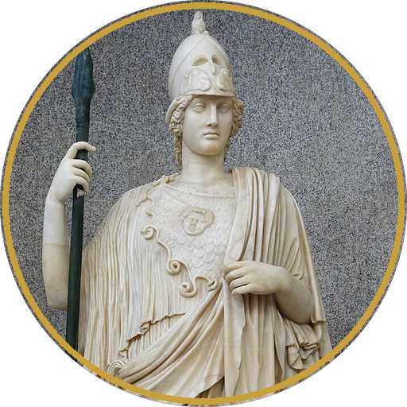
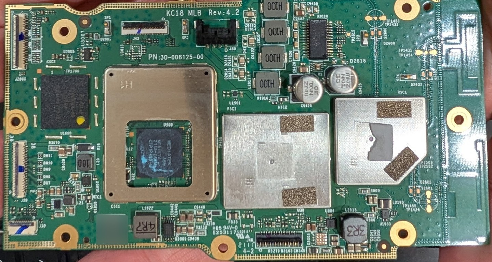
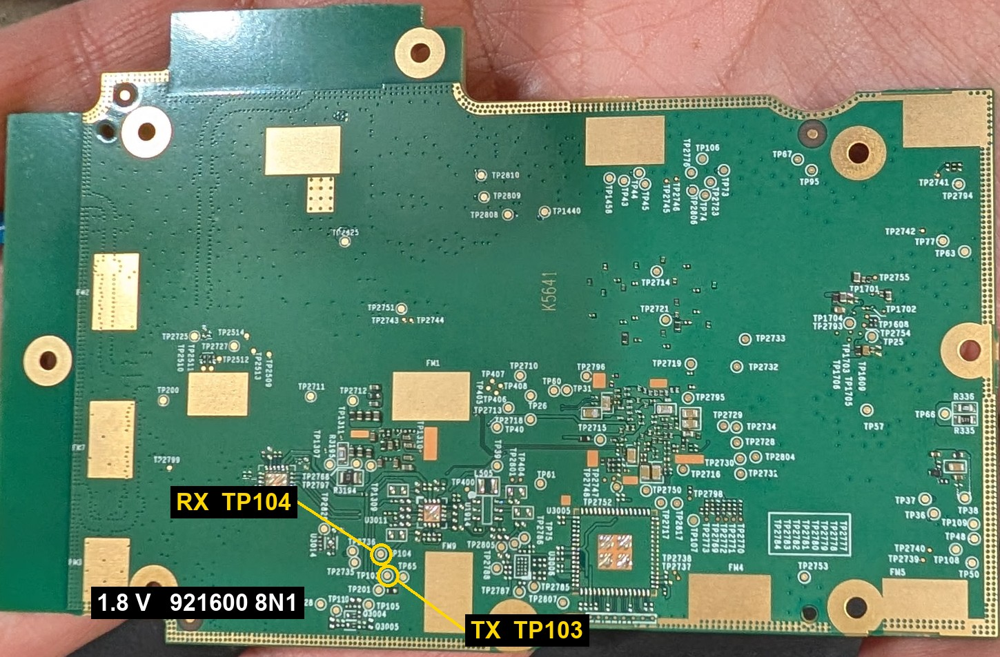

  

<h1 align="center">TECHO5 ATHENA</h1>

<h3 align="center">The Echo Show 8 (2nd gen, 2021) on 64-bit mainline Linux, with Home Assistant in charge and no Amazon cloud.</h3>

  
  
  
  

  <a href="https://github.com/HuskerMinion/techo5/blob/main/docs/install-athena.md"><b>Install guide</b></a> ·
  <a href="https://github.com/HuskerMinion/techo5/releases/latest"><b>Download</b></a> ·
  <a href="https://github.com/HuskerMinion/techo5/tree/main/tools/linux/athena/kernel"><b>Kernel source</b></a> ·
  <a href="#credits">Credits</a> ·
  <a href="https://github.com/HuskerMinion/techo5">TECHO5</a>

---

**ATHENA** is Amazon's codename for the **Echo Show 8, 2nd generation (2021)**, model A8H3N2, a
MediaTek MT8183. TECHO5 replaces Fire OS on it with a 64-bit mainline Linux kernel, a small Alpine
system and the TECHO5 daemon. The Show becomes a Home Assistant voice satellite with its own touch
screen. Your voice goes to your Home Assistant and nowhere else.

The first OS other than Fire OS on this Echo, and the first Echo Show on a mainline kernel that I
can find.

Amazon ships it with a 32-bit kernel. There's no LineageOS for it. So the kernel here is Linux 6.18
from kernel.org, with a device tree and drivers written for this board.

This repo is the front page. The code, the installer, the kernel source and the releases all live in
[TECHO5](https://github.com/HuskerMinion/techo5), along with the other Echo Shows.

> **New in v1.2.19: full speed.** Until now the kernel never scaled the CPUs, so they sat at the
> bootloader's clock, about 1.1 GHz on the little cores and 1.2 GHz on the big ones. Now both clusters
> run from 793 MHz up to 1.99 GHz, the way Fire OS runs them, and the chip slows itself down when it
> gets hot. The update arrives over the air from Home Assistant, kernel included.

## What works

- The screen, with a real display driver, and touch
- All four microphones and the speaker, with Amazon's own tuning for the amp
- Wake word and voice with Home Assistant
- Bluetooth audio from your phone
- Wi-Fi
- The light sensor
- The camera, the 13 MP OmniVision OV13855: live on the screen, a Home Assistant camera, and off
  while muted or with the shutter closed
- Volume and mute buttons
- Updates over the air from Home Assistant, into the spare of two slots, like every TECHO5 device
- Full CPU speed, 793 MHz to 1.99 GHz on both clusters, with temperature control
- Kernel updates over the air too, with the old kernel kept as the way back

Known limits:

- **Only one screen panel is supported so far**, the ILI9881C with BOE glass. Amazon used several
  panels in this model. The installer checks yours. On any other panel it can still put TECHO5 on
  Amazon's kernel instead.
- The light sensor isn't calibrated yet.
- The microphone beamformer is off.

## Speed

Measured with 7-Zip's benchmark, before and after the v1.2.19 kernel:

| | Before | v1.2.19 |
|---|---|---|
| CPU clock | stuck at about 1.1 GHz (little) and 1.2 GHz (big) | 793 MHz to 1.99 GHz, both clusters |
| One big core | 1,700 MIPS | 2,640 MIPS (+55%) |
| All eight cores | 8,900 MIPS | 14,300 MIPS (+60%) |
| Temperature control | none | full speed below 80 °C, slower above |

On all eight cores it now outscores a Raspberry Pi 5: 14,300 MIPS in 7-Zip, against about 8,300 to
11,000 for a Pi 5. One Pi 5 core is still faster than one of its big cores (about 3,500 against 2,640).

Ten minutes at full load on all eight cores peaked at 75 °C, below the 80 °C point where it starts to
slow down, and the scores held steady the whole time.

## How I got here

When the unlock for this Show came out, I figured it would be quick. It was, but It wasn't. The 
unlock went well but then I wanted to put 64-bit Linux on it.  That took some effort!

Amazon ships it with a 32-bit kernel. It now runs TECHO5 on a 64-bit mainline Linux kernel. Getting
there took a serial port soldered to the back of the board and a lot of reading Amazon's kernel to see
how it did things.

Some highlights:

- The audio chips share a bus with a coprocessor that isn't running, so we talk to them by toggling
  pins in software.
- Two of the four mics needed a setting nobody documents. We found it by taking Amazon's kernel apart.
- There's no hardware echo reference, so TECHO5 keeps track of what it played and lines it up with
  what the mics hear.
- Phones dropped Bluetooth right after pairing. The chip makes one kind of key and encrypts with
  another, and Linux didn't like that. Fixed in the driver.
- Wi-Fi and Bluetooth share one chip and fought over it at boot. Bluetooth now waits its turn.

## Install

You need an Echo Show 8 2nd gen that's already unlocked with saiyaku-athena (see
[Credits](#credits)), a computer with Python 3 and adb, and Home Assistant.

**This can brick your Echo Show.** Read the
[install guide](https://github.com/HuskerMinion/techo5/blob/main/docs/install-athena.md) all the way
through first. The installer backs up every partition before it writes anything. Keep that backup.

## The board

  
  

The board is "KC18 MLB Rev 4.2". To get a 64-bit kernel booting I opened one up and went looking for
a serial console. You don't need this to use TECHO5. It's here for anyone porting something else.

| | |
|---|---|
| TX (from the Show) | **TP103**, back of the main board |
| RX (to the Show) | **TP104**, next to it |
| Ground | any mounting-hole ring |
| Level | **1.8 V**. A 3.3 V adapter can damage the board |
| Settings | **921600 8N1** |

The preloader, the bootloader and ATF all print there. Fire OS's own kernel stays quiet.

| Part | Chip |
|---|---|
| SoC | MediaTek MT8183 (4x Cortex-A73 + 4x Cortex-A53) |
| RAM / storage | 2 GB / 8 GB eMMC |
| Wi-Fi + Bluetooth | MediaTek MT7663 (SDIO) |
| Speaker amp | TI TAS5805M |
| Microphones | 4 analog mics on a TI TLV320ADC5140 |
| Panel | 800x1280 DSI (ILI9881C or JD9365, depending on the unit) |
| Touch | FocalTech FT5422 |
| Light sensor | AMS TCS3400 |
| Camera | OmniVision OV13855, 13 MP, 4-lane MIPI CSI-2 |

## Kernel source

The kernel is Linux 6.18.56 from kernel.org plus the patches, device tree, machine driver and config
in [tools/linux/athena/kernel](https://github.com/HuskerMinion/techo5/tree/main/tools/linux/athena/kernel).
Each release also carries the full kernel source it was built from. The build is reproducible.

What the patches add:

- the board's device tree
- an ALSA machine driver for the board (MT8183 audio, TAS5805M, TLV320ADC5140)
- MT8183 audio fixes: clock gates written too early, the second mic input, and a wrong routing
  register
- the display panel init sequences, taken from Amazon's GPL-2.0 kernel for the device
- Bluetooth and Wi-Fi fixes for the MT7663
- TCS3400 support in the light sensor driver
- the camera: MediaTek's sensor interface and CAMSV drivers (from
  [vpavlin/mt8183-camera](https://github.com/vpavlin/mt8183-camera), which runs them on MT8183
  Chromebooks) and a new OV13855 driver. The chip's own image processor needs firmware Linux doesn't
  have, so the raw frames go straight to memory and TECHO5 develops them itself
- USB device mode on this board

## Credits

- **The unlock:** saiyaku-athena and kaeru by [R0rt1z2](https://github.com/R0rt1z2), with bengris32
  and FieryFlames (jackmthws). Thanks to nuno407 for the META mode idea. XDA thread:
  [[UNLOCK][ROOT][TWRP][UNBRICK] Amazon Echo Show 8 2nd Gen - 2021 (athena)](https://xdaforums.com/t/unlock-root-twrp-unbrick-amazon-echo-show-8-2nd-gen-2021-athena.4804958/).
- **The 64-bit Linux port**, the UART, the device tree and the drivers:
  [HuskerMinion](https://github.com/HuskerMinion).
- **TECHO5** grew out of [EchoLocal](https://github.com/ygelfand/echolocal) by ygelfand.

Images:

- ATHENA badge: the *Athena Giustiniani*, Vatican Museums. Photo by Daderot, public domain,
  [Wikimedia Commons](https://commons.wikimedia.org/wiki/File:Athena_Giustiniani_-_Braccio_Nuovo,_Museo_Chiaramonti_-_Vatican_Museums_-_DSC00910.jpg).
- Board photos: HuskerMinion.

## License

The text and images here are free to share with credit. TECHO5's code is MIT, and the kernel is
GPL-2.0; see [TECHO5](https://github.com/HuskerMinion/techo5).
